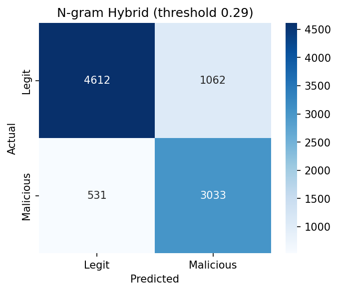
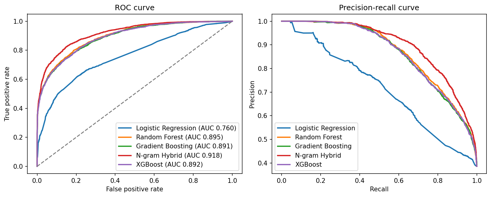

# 🛡️ CyberGuard: ML-Based Malicious URL Scanner


A machine learning project that classifies URLs as **legitimate** or **malicious** from the URL text alone. It ships as a reusable Python package with a command-line tool, a Streamlit web app, tests and CI.

> ⚠️ **Educational project only.** It is not a production security tool. Do not use it to decide whether a link is safe.

## ✨ Features

- **34 lexical features**: length stats, entropy, IP host, `@` symbol, punycode, brand impersonation in subdomains, risky TLDs, shorteners, risky file extensions, percent-encoding and more
- **Leakage-aware evaluation**: train/test split is grouped by registered domain, so one site never appears on both sides
- **Time-based validation**: `--time-split` trains on older URLs and tests on the newest, a realistic check for attackers changing tactics (needs a `date`/`timestamp` column)
- **Error analysis**: the most confident false positives and false negatives are saved to `reports/error_analysis.csv` with their red flags
- **Model comparison**: Logistic Regression, Random Forest, Gradient Boosting, a **character n-gram TF-IDF hybrid** (+ XGBoost if installed) with cross-validation mean and std
- **Calibrated probabilities** on larger datasets
- **Tunable decision threshold**: pick the threshold that keeps recall at or above a target (default 85%)
- **Rich metrics**: accuracy, precision, recall, F1, ROC-AUC, PR-AUC, confusion matrix, ROC and PR curves, feature importance
- **Explainable output**: plain-English red flags plus a per-URL "what moved the score" table (model-agnostic feature impact, no extra dependency)
- **REST API** (FastAPI) with `/predict`, `/predict/batch`, `/health` and auto docs
- **CLI** (`train`, `predict`, `scan`), **Streamlit app**, **pytest suite**, **GitHub Actions CI**, **Dockerfile**

## 🚀 Quick start

```bash
pip install -r requirements.txt
python -m cyberguard train                      # demo set (scores NOT meaningful)
python -m cyberguard train --data data/urls.csv # your real dataset
python -m cyberguard train --data data/urls.csv --time-split   # train on old, test on new
python -m cyberguard predict "http://secure-login.paypal-verify.example-xyz.com/signin"
python -m cyberguard scan urls.csv --column url --output scan_results.csv
```

Example output:

```
MALICIOUS   97.5%  [HIGH]  http://secure-login.paypal-verify.example-xyz.com/signin
    - Brand name appears in the subdomain of an unrelated domain
    - Contains 4 sensitive words (login, verify, ...)
    - Many hyphens in the host name
    - Not using HTTPS
```

### REST API

```bash
pip install fastapi uvicorn
uvicorn api:app --reload      # docs: http://127.0.0.1:8000/docs
curl -X POST localhost:8000/predict -H 'Content-Type: application/json' \
  -d '{"url": "http://secure-login.paypal-verify.example-xyz.com/signin"}'
```

### Web app

```bash
pip install streamlit
streamlit run app.py
```

### Docker

```bash
docker build -t cyberguard . && docker run -p 8501:8501 cyberguard
```

### Notebook

Open `CyberGuard_ML_URL_Scanner.ipynb` (Jupyter or Colab) for the step-by-step walkthrough.

## 📂 Dataset

Your CSV needs a `url` column and a `label` (or `type`) column. `benign`, `legitimate`, `safe`, `0` count as safe; anything else counts as malicious. Possible sources (check each licence): Kaggle "Malicious URLs", PhishTank, Tranco. With no dataset, a **tiny demo set** is used and scores are **not meaningful**.

## 📊 Results

Run on Google Colab with the Kaggle **"Malicious URLs dataset"** (`malicious_phish.csv`): a sample of about 46,000 URLs, with benign vs phishing/malware/defacement merged into one malicious class. Test set: 9,238 URLs held out, grouped by domain so no website appears in both train and test. Scores below use a 0.5 threshold.

| Model | Accuracy | Precision | Recall | F1 | ROC-AUC | PR-AUC | CV F1 (grouped) |
|---|---|---|---|---|---|---|---|
| **N-gram Hybrid** | **0.847** | 0.831 | **0.755** | **0.792** | **0.918** | **0.896** | 0.785 ± 0.034 |
| Random Forest | 0.821 | 0.843 | 0.658 | 0.739 | 0.895 | 0.870 | 0.711 ± 0.012 |
| XGBoost | 0.818 | 0.835 | 0.657 | 0.736 | 0.892 | 0.865 | 0.707 ± 0.012 |
| Gradient Boosting | 0.816 | 0.830 | 0.656 | 0.733 | 0.891 | 0.865 | 0.719 ± 0.025 |
| Logistic Regression | 0.734 | 0.774 | 0.439 | 0.560 | 0.760 | 0.705 | 0.612 ± 0.033 |

**Operating point.** The project picks the decision threshold that keeps recall at or above 85%. For the best model that is 0.29, which gives precision 0.74, recall 0.85 and an 18.7% false-alarm rate (3,033 threats caught, 531 missed, 1,062 safe URLs flagged). Raise the threshold for fewer false alarms, lower it to catch more threats.




### Error analysis

The most confident mistakes are saved in `reports/error_analysis.csv`. What they show:

- **Label noise in the dataset.** Many "false alarms" are clearly phishing but labelled benign, for example an eBay `SignInUsingSSL3` page and `supportservice-amazon.de/verifi.htm`. Checking the data directly: of URLs with "paypal" hidden in the subdomain of another domain, **418 are labelled benign and only 57 malicious**, although the benign ones look like classic PayPal phishing. So some "errors" are the model being right and the label wrong.
- **Hacked but normal-looking sites.** Some misses, such as `amharicdictionary.com/NewWords.aspx`, carry no signal in the URL text. Detecting them needs page content or reputation data.
- **Unreadable strings.** Some malware-class entries are binary garbage rather than URLs.
- **Scheme artifact (fixed).** An earlier run scored higher because `http(s)://` and `www.` differed between benign and malicious URLs in this dataset. They are now removed before feature extraction.

Because of the label noise, treat these scores as a lower bound on how well the model reads URL structure. A cleaner dataset (PhishTank for phishing, Tranco for popular benign domains) should score higher.

## 🧼 Training on cleaner data (PhishTank + Tranco)

The Kaggle file has noisy labels (see error analysis). To compare with cleaner data:

1. Download (check each licence and terms): **PhishTank** `verified_online.csv` and the **Tranco** top-1m list.
2. Build a balanced CSV:
   ```bash
   python scripts/build_clean_dataset.py --phishtank verified_online.csv --tranco top-1m.csv \
          --per-class 20000 --out data/clean_urls.csv
   python -m cyberguard train --data data/clean_urls.csv
   ```
3. Report both datasets side by side in your Results section.

**Why host-only by default:** Tranco lists domains without paths, while phishing URLs have paths. If left as is, a model just learns "has a path = phishing". The script reduces both classes to host names so the comparison is fair. This means path-based features are unused on this dataset, so expect different strengths than on the Kaggle data. Tranco has no dates, so `--time-split` is not available with it.

## 🗂️ Project structure

```
cyberguard/
├── cyberguard/
│   ├── features.py     # feature extraction + red-flag explanations
│   ├── data.py         # loading, label cleaning, domain-grouped split
│   ├── ngram.py        # char n-gram TF-IDF hybrid model
│   ├── modeling.py     # training, metrics, threshold, save/load, predict
│   ├── plots.py        # report charts
│   └── cli.py          # python -m cyberguard ...
├── scripts/            # build_clean_dataset.py (PhishTank + Tranco)
├── tests/              # pytest suite
├── app.py              # Streamlit app
├── api.py              # FastAPI service
├── CyberGuard_ML_URL_Scanner.ipynb
├── Dockerfile · requirements*.txt · LICENSE · .github/workflows/ci.yml
```

## ✅ Tests

```bash
pip install pytest && pytest -q
```

## 🔍 Error analysis template

After training on real data, open `reports/error_analysis.csv` and add a short section here, for example:

- **False positives:** which kinds of legitimate URLs get flagged (login pages, long tracking links)? Which feature drives it? (`predict --why`)
- **False negatives:** which threats slip through (clean-looking domains, no brand words)? What extra signal would catch them?
- **What you would change next** based on both lists.

## 🧠 Limitations

- Uses **URL text only**: no page content, domain age, SSL details or reputation lists
- Words like "login" also appear on real sites, so false alarms are possible
- Results depend on the dataset; mixed sources can inflate scores
- Attackers change URLs often, so models go stale
- The `http(s)://` prefix and leading `www.` are removed before feature extraction on purpose: in the Kaggle "Malicious URLs" data, benign and malicious URLs differ in these (a collection artifact), and models would learn that shortcut. The "Not using HTTPS" red flag is shown only as an explanation, not used by the model

## 🔭 Roadmap

- Re-train on cleaner labels (PhishTank + Tranco) and compare
- Popular-domain (Tranco) allowlist feature to cut false alarms on famous sites
- WHOIS / domain-age features
- Full SHAP explanations (current ones use a simpler median-replacement method)
- Hosted live demo (Streamlit Cloud / Hugging Face Spaces)

## 👨‍💻 Author

**Harpreet Singh** · GitHub: _add link_ · LinkedIn: _add link_ · YouTube: _add link_

## 📄 Licence

MIT. See [LICENSE](LICENSE).
